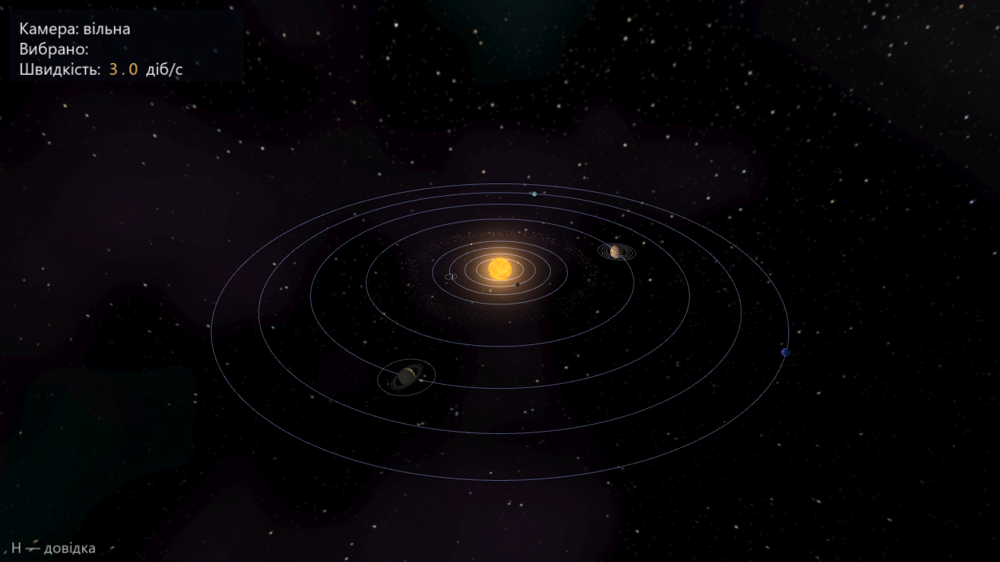
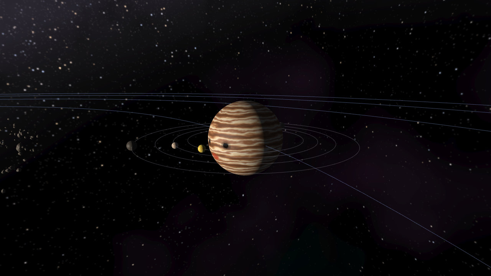
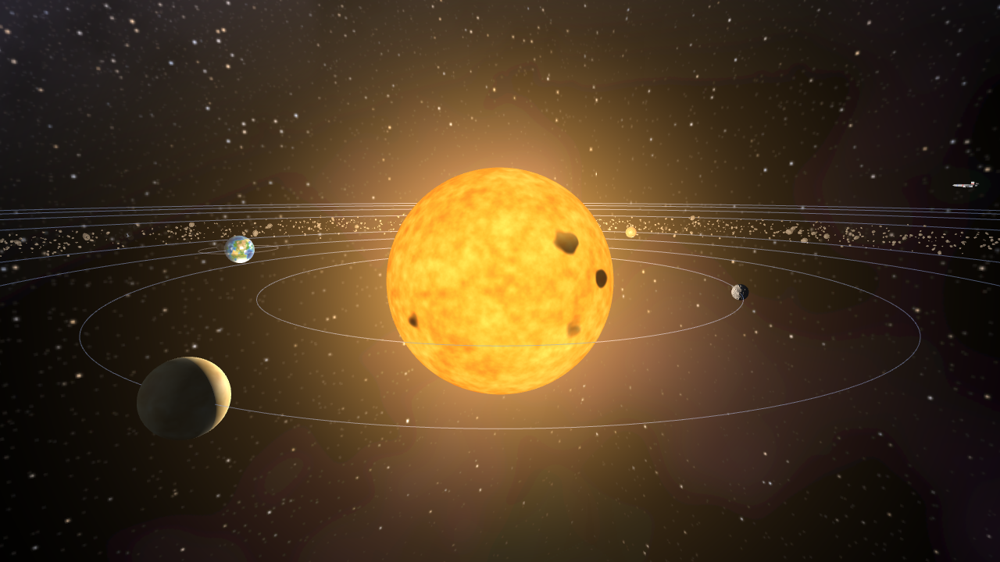
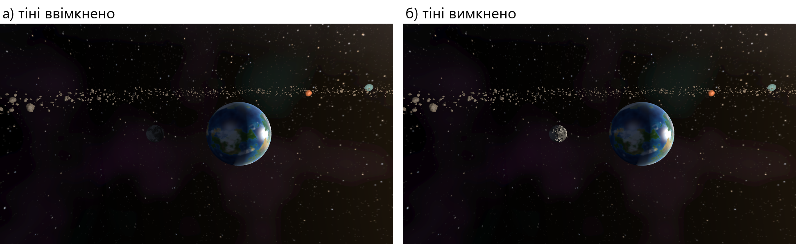
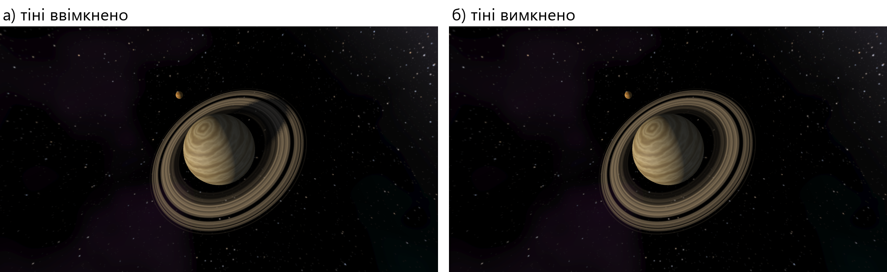
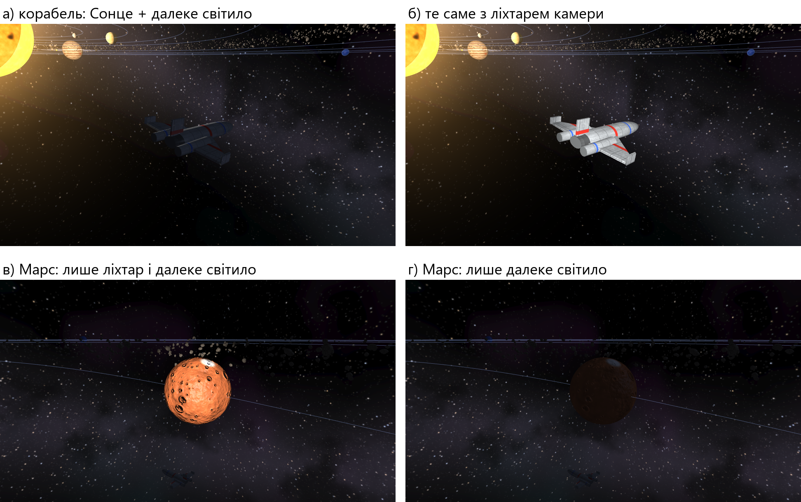

# 🪐 Модель Сонячної системи на OpenGL 3.3

Лабораторна робота №3 з комп'ютерної графіки — «Створення ігрової сцени».
Тривимірна модель Сонячної системи: 15 небесних тіл, космічний корабель і пояс із 2600 астероїдів.

Написано на **C++17** для **OpenGL 3.3 core** з бібліотекою **GLFW 3.4**. Усе інше — власне: лінійна алгебра
(вектори, матриці 4 × 4, кватерніони), завантажувач функцій OpenGL, завантажувачі TGA та OBJ.
Текстури, небо й моделі створює скрипт `tools/make_assets.py`, зовнішніх зображень немає.



## Що реалізовано

| Технологія | Як реалізовано |
|---|---|
| **Камера (повністю 3D)** | вільна камера на кватерніоні без обмежень кутів і «кардану» + орбітальна камера навколо вибраного тіла |
| **Текстури** | кольорові карти (sRGB), карти нормалей, дзеркальності, кільце Сатурна з прозорістю; міпмапи й анізотропна фільтрація |
| **Моделі** | завантажувач Wavefront OBJ: корабель (1144 трикутники) і астероїд (320 трикутників) |
| **Матриці трансформацій** | уся геометрія на власних `Mat4`/`Quat`; ієрархія «батько → дитина»: супутники рухаються разом із планетами |
| **Освітлення, кілька джерел** | модель Блінна–Фонга: точкове Сонце, напрямлене далеке світило, прожектор камери; карти нормалей |
| **Тіні** *(додатково)* | кубічна карта глибини від Сонця з м'якими межами (PCF): місячне й сонячне затемнення, тінь Сатурна на кільці й кільця на планеті |
| **Кубічні карти** *(додатково)* | небо, відбиття неба на корпусі корабля, кубічна карта тіней |
| **Трафарет** *(додатково)* | контур вибраного тіла |
| **Геометричний шейдер** *(додатково)* | шарове відтворення карти тіней (1 трикутник → 6 граней), показ нормалей сфери |
| **Інстансинг** | пояс із 2600 астероїдів малюється одним викликом |

## Знімки

Усі знімки зроблено самою програмою в режимі `--shot`.

| | |
|---|---|
|  |  |
| Юпітер із галілеєвими супутниками | Сонце з ореолом, позаду небо з кубічної карти |

**Місячне затемнення**: тіні ввімкнено / вимкнено



**Тінь Сатурна на кільці**: тіні ввімкнено / вимкнено



**Освітлення кількома джерелами**: Сонце + далеке світило, ліхтар камери, лише ліхтар, лише далеке світило



## Збирання й запуск

Потрібні Windows, [MSYS2](https://www.msys2.org/) (підсистема UCRT64) і відеокарта з підтримкою OpenGL 3.3.
Перевірено з g++ 15.1.0 та GLFW 3.4 на Windows 11.

```bash
pacman -S mingw-w64-ucrt-x86_64-gcc mingw-w64-ucrt-x86_64-glfw
mingw32-make          # збирає bin/scene3d.exe і bin/selftest.exe
mingw32-make check    # самоперевірка
mingw32-make run      # запуск програми
```

Каталог `assets/` має лежати поруч із `bin/`; тоді програму можна запускати з будь-якого місця.
Готові текстури й моделі вже в репозиторії; щоб створити їх заново: `python tools/make_assets.py`
(Python 3, numpy, Pillow).

## Керування

| Клавіша | Дія |
|---|---|
| `W` `A` `S` `D`, `Пробіл` / `Ctrl`, `Shift` | політ камерою; вгору / вниз; прискорення |
| права кнопка миші, `Q` / `E` | огляд (в орбітальному режимі — обертання навколо тіла); крен |
| колесо миші | швидкість польоту (в орбітальному режимі — відстань до тіла) |
| `Tab` / `Shift+Tab`, `1`…`9`, `0` | вибір тіла; політ до тіла: Сонце, Меркурій, …, Нептун, корабель |
| `C`, `R` | орбітальна / вільна камера; загальний вид |
| `,` `.` `P` | повільніше / швидше (діб за секунду); пауза |
| `G` `F` `N` `T` `O` `B` `L` `X` | тіні · ліхтар · нормалі · текстури · орбіти · пояс · Сонце · контур |
| `H` `I` `F12` `Esc` | довідка · інтерфейс · знімок екрана (TGA) · вихід |

### Командний рядок

```bash
scene3d --shot файл.tga --view earth --time 100 --size 1280x720   # один кадр без вікна
scene3d --list-views                                              # перелік готових ракурсів
scene3d --help                                                    # усі параметри
```

## Структура

```
.
├── Makefile
├── src/
│   ├── Math.h                       вектори, матриці 4×4, кватерніони
│   ├── GlFuncs.*                    завантаження функцій OpenGL 3.3
│   ├── Shader.* Texture.* Mesh.*    ресурси на GPU
│   ├── Geometry.* Assets.*          сфера, кільце, куб, OBJ; файли й TGA
│   ├── Camera.* SolarSystem.*       камера й модель сцени
│   ├── Presets.*                    готові ракурси
│   ├── Renderer.* Offscreen.* Hud.* відтворення кадру
│   └── main.cpp                     вікно, введення, головний цикл
├── assets/
│   ├── shaders/                     GLSL 3.30: планети, Сонце, небо, тіні, нормалі, ореол, інтерфейс
│   ├── textures/                    TGA: кольори, нормалі, небо, кільце, атлас інтерфейсу
│   └── models/                      OBJ: корабель, астероїд
├── tests/selftest.cpp               самоперевірка
└── tools/make_assets.py             генератор текстур, неба й моделей
```

## Самоперевірка

`bin/selftest.exe` створює приховане вікно й виконує 59 перевірок: математика матриць і кватерніонів, ієрархія
й періоди обігу, геометрія затемнень, формати файлів, шейдери, а також порівняння пікселів готових кадрів
(тіні, контур за трафаретом, кубічна карта, інстансинг, інтерфейс).
Щоб переконатися, що перевірки не порожні, у копію проєкту по одній вносили 17 навмисних поломок —
самоперевірка виявила всі 17.
